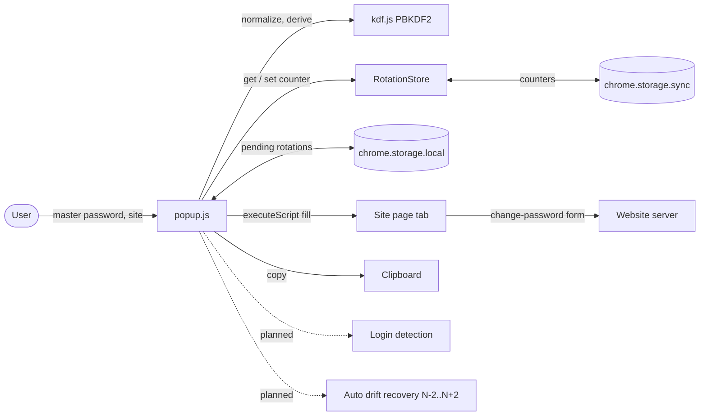
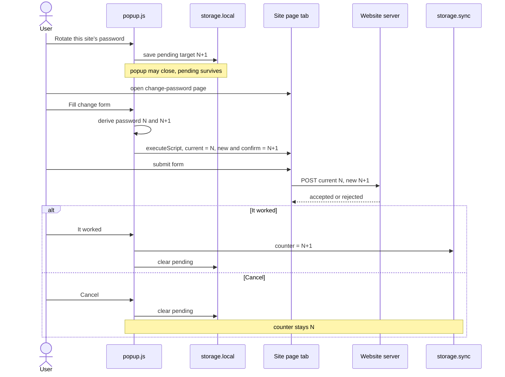
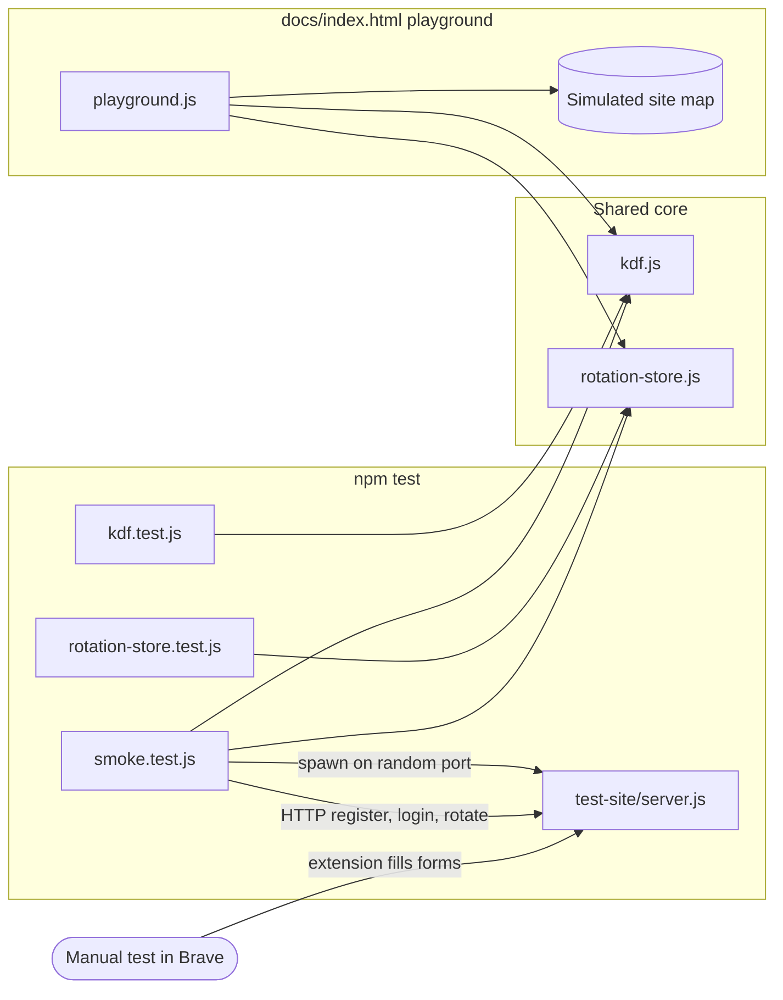

# Passrotor architecture

Passrotor is a Manifest V3 extension with no background worker: all logic runs in the popup (`popup.js`) while it is open. It derives each site's password from `(master password, domain, counter)` and keeps only the counter.

Dashed arrows are planned parts from the idea's Next steps. Nothing on those arrows exists in the code yet.

## Parts and data flow

- `kdf.js`: PBKDF2-SHA256, 250,000 iterations, salt `domain:counter`, formatted as a 20-character password.
- `RotationStore` uses the same `normalizeDomain` as `kdf.js`, so a counter and its derivation always refer to the same site. The popup loads `store.counters` from sync storage and writes it back after each change.
- **Fill login** and **Fill change form** only run when the site field matches the open tab's hostname.

## What is stored where

| Data | Where it lives | Leaves the device |
|---|---|---|
| Master password | Popup memory, until the popup closes | No, never stored |
| Derived passwords | Popup memory; the page's password fields after a fill; the clipboard after Copy | Yes, to the website when you submit |
| `{domain: counter}` | `chrome.storage.sync` | Yes, through browser account sync |
| `{domain: target counter}` for a started rotation | `chrome.storage.local` | No |

Trust boundaries, from most to least trusted:

1. **Popup.** The only place the master password exists.
2. **Browser sync.** Holds counters only. Anyone who reads them learns which sites you use and how often you rotated, not any password.
3. **Page tab.** `executeScript` writes the derived password into the page DOM, so the page's own scripts can read it. A filled password is only as safe as the site it is filled on.
4. **Clipboard.** Any app on the machine can read it until it is overwritten.

## Two-step rotation

The website has no rotor of its own, so the counter may only move after the site has accepted the new password.

Passrotor never sees the site's answer. If you click "It worked" after a rejected change, the counter drifts ahead of the site. You fix that with the -/+ buttons today, and with automatic drift recovery later (planned).

## Testing and playground

None of this ships in the extension. It runs the same `kdf.js` and `rotation-store.js` outside the browser extension.

- `test-site/server.js` keeps accounts in memory and shows the stored password on its account page, which a real site would never do. Run it with `npm run test-site` on `http://localhost:8080`.
- The playground has no extension APIs. It replaces the website with an in-memory map and follows the same rules: a password change needs the current password, and the counter moves only on "It worked".
