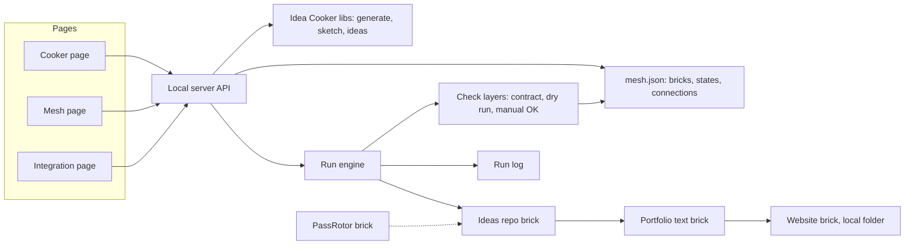

# IdeaMesh architecture

IdeaMesh is one local server with three pages: Cooker, Mesh and Integration. The server reuses Idea Cooker's libraries to cook and sketch bricks. It keeps the brick registry, with each brick's state and connections, in `mesh.json`. A run engine sends an idea through the bricks in order. The website brick writes to a local folder for now, and every run is logged.

A brick can only run in the mesh after it clears its check layers. The first gate in use is "Sketch approved", meaning the brick's UI sketch was reviewed on the Cooker page. Contract, dry run and manual OK are the planned next gates.

