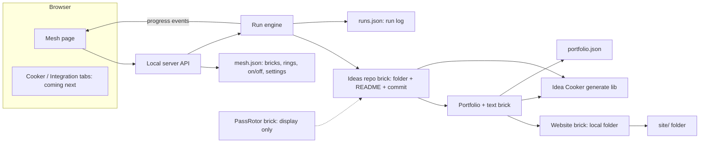

# IdeaMesh architecture

The first prototype is a local Node server (`server.mjs`) with one working page, the Mesh page. The Cooker and Integration tabs only say they come next.

- `lib/store.mjs` reads and writes `mesh.json`, which holds the bricks, their rings, on/off state, settings and connections. It also handles `runs.json` and `portfolio.json`.
- `lib/engine.mjs` is the run engine. It follows the solid connections from the prompt and calls one brick at a time. It skips bricks that are off, can't run yet, or haven't passed "Sketch approved". After the first failure it stops the chain.
- `lib/bricks.mjs` holds the three runnable bricks, built on Idea Cooker's modules, which are imported from `../2026-11-25-idea-cooker/lib/`.
- The page follows a run through server-sent events from `/api/events`.

PassRotor is shown in the network but is never called during a run.

The Portfolio brick calls Claude through the Claude SDK that Idea Cooker already installed. Idea Cooker's generate lib has no plain text-generation function, so this call goes to the SDK directly.
