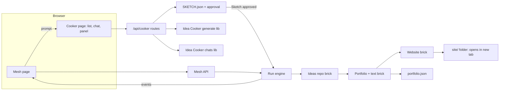

# IdeaMesh architecture

IdeaMesh is one local Node server (`server.mjs`) with two working pages, Mesh and Cooker. The Integration tab still says it comes next.

- **Cooker page** (`public/cooker.js`, API in `lib/cooker.mjs` under `/api/cooker/...`): cooks and changes ideas the way Idea Cooker does, using its `generate`, `chats`, `ideas`, `git` and `sketch` modules.
  - Design questions come first and show as option buttons. The chat session resumes for follow-ups.
  - The chat history is shared with Idea Cooker (its `chats/` folder).
  - Idea Cooker's sketch editor and Mermaid are served from its folder.
- **Sketch approval** is the first check layer. Approving stores a hash of `SKETCH.json` in `approvals.json`, and any later edit resets it. Only an approved idea can be sent through the mesh.
- **Mesh page** (`public/index.html`, `lib/store.mjs`, `lib/engine.mjs`, `lib/bricks.mjs`): the run engine calls the bricks in order.
  - The Ideas repo brick cooks and commits a new idea from a typed prompt. For an idea that comes from the Cooker, it reuses the folder that already exists.
  - The run log previews the portfolio entry. The generated web page is linked from the Cooker page and opens in a new tab.
- **Prototypes** are served read-only on the next port up (`PORT + 1`), a different origin, so their scripts can't call the API.

Cooker jobs and mesh runs share one lock, so only one of them writes to the repo at a time.

The Portfolio brick calls the Claude SDK that Idea Cooker already installed. Idea Cooker's generate lib has no plain text-generation function, so this call goes to the SDK directly.
